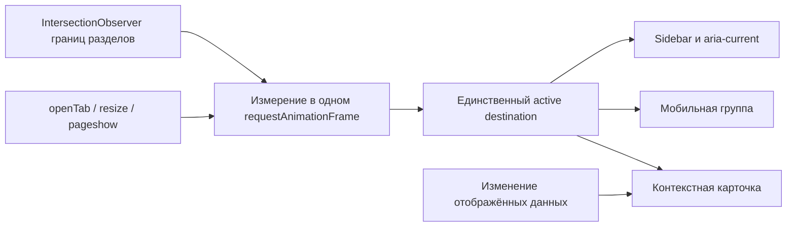

# Финальная визуальная полировка — 2026-11-14

База: release-candidate `f9d2137843edf233c847f157a0d4e48d9f160da3`. Изменения публикуются только в rc1-visual-polish. Main и release-candidate не обновляются. SHA проверенной сборки и окончательный conclusion: [Actions визуальной ветки](https://github.com/KerixSq/bashkir-language-school/actions?query=branch%3Arc1-visual-polish). Успех означает завершённый workflow со всеми четырьмя jobs success.

## Найдено и исправлено

- Sidebar имел height:100vh/overflow-y:auto независимо от высоты содержимого, несколько конфликтующих слоёв стилей и активный пункт только по клику. Новый тест до исправления упал на отсутствующей контекстной области. Геометрия собрана в одном действующем правиле: sticky, align-self:start, top:0, height:100dvh. Основной scroll — у документа; при обычной высоте отдельной прокрутки панели нет. Измеренное переполнение на 2 px при 900 px устранено отступами.
- На низких экранах сначала скрываются картинка/подробности контекста, ниже 680 px — второстепенный блок; только тогда разрешена тонкая прокрутка панели. Все девять пунктов достижимы с клавиатуры. Мобильная нижняя панель сохранена.
- Контекстная карточка имеет постоянную высоту на обычном desktop, не сдвигает меню при смене текста. Краткая подпись ограничена четырьмя строками; полные сведения доступны в основном разделе. На маленькой высоте остаётся только главное действие.
- Исправлены пограничный scrollspy после перехода на короткую вкладку и повторный вход в уже выбранную вкладку: первый вход сохраняет загрузку/ошибку, повторный клик не инициирует лишний запрос.
- Из JuryHome удалены вымышленные школы, классы и никнеймы. До получения API показывается «Нет данных» и пояснение, без нулей вместо неизвестных значений. Заголовок «Лидеры недели» заменён на «Рейтинг сообщества», чтобы не противоречить выбранному периоду.

## Синхронизация

Обрабатываются hero, карта, серверная проверка, тренировка, библиотека, достижения и общий заголовок вкладок. IntersectionObserver использует верхнюю четверть viewport (`rootMargin: 0 0 -75% 0`); тяжёлого scroll-listener нет. ResizeObserver следит за высотой main. Скрытые tabpanel не наблюдаются: раздел вкладок берёт состояние из существующего openTab и aria-selected. При коротком контенте учитывается нижняя граница страницы. Для вкладок без отдельного пункта sidebar используется общая «Главная»; мобильные пункты группируют уроки, проверку и библиотеку под «Уроки». Нет второй системы переключения API-вкладок.

Контекст берёт тренировочные XP/этап/награды из уже отрисованного тренажёра, серверные очки — только при настоящем профиле, библиотеку — из реального счётчика API, период — из существующих кнопок. MutationObserver обновляет только подпись, без запросов. Изменение XP дополнительно проверено после настоящего урока из пяти заданий. Действия ведут в существующие урок, задание, таблицы, экспорт и коллекцию.

## Оформление и тексты

Сохранены все изображения Акбузата и игровая карта. Кремовый фон, глубокий зелёный для действий, тёмный бирюзовый для навигации, приглушённое золото для небольших акцентов. Уменьшены жирность навигации, разноцветность вспомогательных карточек и тяжёлые нижние рамки. Локальные focus-visible и prefers-reduced-motion сохранены. Удалён старый бирюзовый слой sidebar; геометрия не дублируется в новых override. Остальной исторический CSS целиком не переписывался.

Главная теперь прямо называет башкирский язык и два действия: тренировка и коллективная проверка. В основном действии сохранён настоящий запуск урока. Убраны обещания «нового открытия», вымышленные рейтинги и указание «форма слева», неверное на мобильном. Ошибка локальной библиотеки входа больше не отправляет ученика искать CDN. Лицензии/атрибуция БГПУ и предупреждения о лингвистических ограничениях сохранены.

SVG bashkir-border.svg нарисован здесь из простых симметричных ромбов, без копирования чужих изображений. Использован только в баннере и небольшом разделителе. Это современная стилизация, не утверждение об исторически точном узоре. Заданный адрес страницы «Башкирский палас» Роспатента вернул 502; доступный [материал Роспатента о паласе](https://rospatent.gov.ru/ru/news/22-03-2025-bashkiriya-poluchila-svidetelstvo-gosregistracii-brenda-bashkirskiy-palas) использован как культурный ориентир, не источник графического ассета.

## Реальные проверки

| Проверка | Результат |
|---|---|
| compileall, 151 unit, check_contract, Ruff check/format | PASS |
| Новый browser_navigation_checks | PASS Chromium/WebKit: 1440×900, 1152×720, 960×600, 720×450, 1024×600, 390×844 |
| Scrollspy/контекст | PASS вниз/вверх, один active, вкладки, reload, высота контента, низкий экран, клавиатура, мобильная группа, реальный урок/XP |
| Повтор выбранной вкладки | PASS: дополнительного REST-запроса нет |
| Visual checks | PASS 360/390/768/1024/1440/1920, длинный текст, offline CDN, фокус, отсутствие горизонтального scroll |
| Mobile checkpoint | PASS Chromium Pixel 7 / WebKit iPhone 13: пять упражнений, ошибка, WAV, результат, карта, профиль, сохранение прогресса |
| TTS и original audio | PASS: реальные WAV; Chromium/WebKit MP3/PCM, stop/range, retry, 404, клавиатура, смена задания |
| Изолированная QA integration | PASS: 12 PostgreSQL-сценариев, aiogram, эксперт → решение → REST, smoke/RLS/doctor; Telegram transport подменён |
| Полный Docker локально | SKIP: daemon недоступен; выполняется отдельным CI job |
| Live Telegram / физические устройства | SKIP, визуальная задача их не запускает |

125/150/200% проверены эквивалентом доступного viewport на экране 1440×900, а не физическим переключением масштаба Windows. Существующие visual checks дополнительно проверяют reflow. Не заявляется проверка всех сочетаний шрифтов/OS/browser zoom.

## Снимки до/после

Локальные артефакты (не входят в Git):

- `test-results/visual-polish/before/`: home, lesson, finish, expert, zoom — шесть ширин.
- `test-results/visual-polish/after/`: те же состояния и chromium/webkit-navigation-*.png.
- `test-results/checkpoint/`: видео настоящего локального урока и mobile screenshots.

Визуально просмотрены home-1440 до/после, home-390 после, desktop-navigation после. Исправлены отдельная строка с тире в мобильном заголовке и пересечение орнамента с подписью. Повторены автоматические снимки. CI загружает after и остальные текущие свидетельства в interface-screenshots; before сохраняется локально, не создаётся заново из изменённого кода.

Первые CI-прогоны обнаружили превышение ограничения высоты мобильного баннера на Linux со шрифтом подстановки. Уменьшены мобильные интервалы, межстрочный интервал и адаптивный размер заголовка; добавлена диагностика размеров. Ограничение существующего теста не ослаблялось. Окончательный результат — последний завершённый workflow, а не неуспешные попытки.

## Файлы и ограничения

Изменены web/index.html, tests/test_academy_ui.py, tests/test_jury_polish.py, tests/browser_visual_checks.py (диагностика без ослабления проверки), .github/workflows/ci.yml. Добавлены web/assets/navigation.js, visual-polish.css, bashkir-border.svg, tests/browser_navigation_checks.py и этот отчёт.

SQL, бот, API, очки/консенсус/рейтинговые формулы и рабочие данные не менялись. 40 TTS-записей не покрывают всю колоду; качество языка носителем не проверено. Подлинного исходного аудиокорпуса не добавлено. Исторические CSS-слои вне навигации сохранены ради стабильности; это локальная консолидация, не полный рефакторинг. Контекст на низкой высоте намеренно сокращён. Реальные серверные операции подтверждаются QA/CI, скриншоты пустого состояния их не заменяют.

Повтор PowerShell: `python tests/browser_navigation_checks.py`, `python tests/browser_visual_checks.py` после установки существующих requirements-dev и браузеров Playwright Chromium/WebKit. Сервер для этих двух тестов поднимается автоматически на свободном loopback-порту. Публикация не означает развёртывание на VPS.
